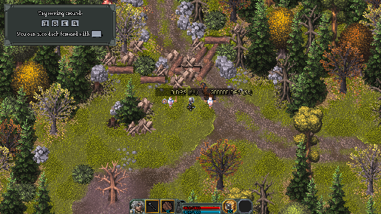

# Training dummy DPS

Part of Quality of Life. A gold `123 DPS (5s)` label above every nearby town
training dummy shows **actual health lost in the last five gameplay seconds / 5**.
It includes direct hits, damage over time, summons and, in co-op, all players'
damage to that dummy. It is not per-player attribution or tooltip DPS.

Captured in GameLab `mod-dummydps 20261105-201116`, build 25932569, before
integration with current main. Controlled 1,000,000 HP loss produces 200,000 DPS;
the other dummy remains at zero. This is a real historical test frame, not a
fresh natural-combat or multiplayer demonstration.

- Attack for at least five seconds to fill the window before comparing builds.
- Stop damaging the dummy for five seconds to return to zero. Lingering DoTs count.
- Each dummy has its own window. Leaving town/range or disabling the module clears it.
- Player menu > HammerwatchPlus > Quality of Life > Training dummy DPS turns it off
  locally, immediately. Nothing is saved; no unit data or combat behavior is changed.
- Health is sampled per frame; tiny hits inherit the game's float-HP precision,
  simultaneous healing can mask damage, and damage before discovery is not included.
  Targets are discovered every 250 ms within 600 world units (at most 32).
- Dead/destroyed dummies are dropped; this is a live-target meter, not an overkill
  or time-to-kill report. Use the durable dummies for sustained comparisons.

## Checks

Run `mod-dummydps` in GameLab lab mode for controlled damage/window and rendering
checks. Also compile/load `mod-all` and `pkg-qol` after package changes.
Manual solo/co-op checklist: hit each town dummy (normal, armored, resistant and
fragile); check independent labels, DoT tails and summons; sustained fire for >5 s;
stop and wait for zero; toggle off/on; pause; change GUI scale; leave/re-enter town.
In two-player play, confirm both peers see combined damage, not duplicate hits.

Automated coverage is controlled HP loss, not natural attacks, DoT attribution or
multiplayer proof. The window self-test covers exact expiry, same-frame aggregation,
healing exclusion, independent windows and game-clock wraparound. Current evidence
and source pins are in `docs/RE_NOTES.md`.
